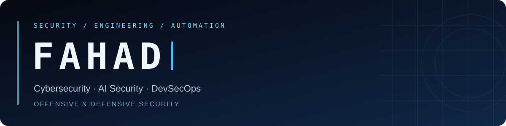

# Hi, I'm Fahad Adeel

**Cybersecurity tools · Python · DevSecOps**

I build small, testable security tools and cloud delivery demos. My recent work focuses on defensive log analysis, security configuration review, and making CI checks reproducible.

## Featured work

### [LLM Prompt-Injection Evaluation Lab](https://github.com/FAHAD-s3do/llm-prompt-injection-evaluation-lab)
Offline evaluation of synthetic prompt-injection cases with explicit scoring and coverage reporting.

[](https://github.com/FAHAD-s3do/llm-prompt-injection-evaluation-lab/actions/runs/40257477032) · [Run instructions and toy examples](https://github.com/FAHAD-s3do/llm-prompt-injection-evaluation-lab#run) · [Example fixtures](https://github.com/FAHAD-s3do/llm-prompt-injection-evaluation-lab/tree/main/examples)

```bash
python3 evaluate.py --responses examples/toy-unsafe.json
python3 -m unittest discover -s tests -v
```

The linked main-branch CI run passed on Oct 26, 2026. Fixtures are synthetic; this project does not benchmark live models.

### [DevSecOps Pipeline Demo](https://github.com/FAHAD-s3do/devsecops-pipeline-demo)
A test-driven Python health service with a static policy gate and hardened container CI.

[](https://github.com/FAHAD-s3do/devsecops-pipeline-demo/actions/runs/40623263128) · [Run instructions and examples](https://github.com/FAHAD-s3do/devsecops-pipeline-demo#run) · [Container smoke-test run](https://github.com/FAHAD-s3do/devsecops-pipeline-demo/actions/runs/40623263128)

```bash
python3 -m unittest discover -s tests -v
python3 security_gate.py app.py
```

### [Web Security Header Auditor](https://github.com/FAHAD-s3do/web-security-header-auditor)
Offline-first Python checks for common HTTP security headers, with review-oriented findings.

[](https://github.com/FAHAD-s3do/web-security-header-auditor/actions/runs/40989657868) · [Run instructions and sample fixtures](https://github.com/FAHAD-s3do/web-security-header-auditor#run) · [Workflow diagram](https://github.com/FAHAD-s3do/web-security-header-auditor/blob/main/assets/workflow.svg)

```bash
python3 auditor.py --fixture examples/headers.json
python3 -m unittest discover -s tests -v
```

## More security tools

- [SSH Login Anomaly Analyzer](https://github.com/FAHAD-s3do/ssh-login-anomaly-analyzer) — offline SSH authentication log correlation.
- [File Integrity Monitor](https://github.com/FAHAD-s3do/file-integrity-monitor) — SHA-256 baselines and coverage-aware change reports.
- [Linux Threat Hunter](projects/linux-threat-hunter/README.md) — local triage of processes, sockets, persistence configuration, and SSH logs.

## Demonstrated skills

Python · unit testing · input validation · defensive log analysis · CI workflows · Docker · AWS ECR/ECS delivery

## Currently learning

Cloud security, detection engineering, and AI application security. These are current study areas; the projects above show the implementations and checks I can demonstrate.

## Learning background and lab notes

I have completed cybersecurity coursework and am continuing studies in DevOps, cloud infrastructure, and artificial intelligence. [Selected lab records](labs/README.md) distinguish reconstructed notes from work with original implementation evidence.

Security testing is limited to systems I own or am explicitly authorized to assess.

[LinkedIn](https://www.linkedin.com/in/fahad-a-845013279)
