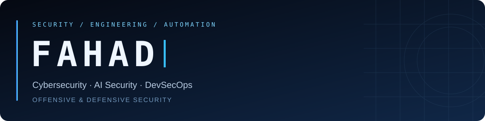

  
  

# Fahad Adeel

**Cybersecurity · AI Application Security · DevSecOps · Cloud & Linux Automation**

I’m a computer science student focused on practical cybersecurity engineering. I work across web application security, AI application security testing, defensive security automation, and secure cloud delivery.

I build small, reproducible tools and document how they work, how they are tested, and where their limitations are. My goal is to develop the engineering depth to help secure modern applications, infrastructure, and AI-enabled systems.

- **Current focus:** AI application security, web security testing, Linux/Bash automation, and DevSecOps.
- **Security approach:** understand the attack surface, validate findings with evidence, and document practical remediation.
- **Learning path:** cybersecurity, cloud infrastructure, containers, and AI operations.

---

## Selected projects

| Project | What it does |
|---|---|
| [Web Security Header Auditor](https://github.com/FAHAD-s3do/web-security-header-auditor) | Python CLI for reviewing HTTP security headers, cookie attributes, and selected CORS configurations. Includes offline fixtures, tests, and JSON/HTML reporting. |
| [SSH Login Anomaly Analyzer](https://github.com/FAHAD-s3do/ssh-login-anomaly-analyzer) | Offline SSH log analysis that correlates failed-login bursts with subsequent successful authentication. |
| [LLM Prompt-Injection Evaluation Lab](https://github.com/FAHAD-s3do/llm-prompt-injection-evaluation-lab) | Reproducible evaluator for synthetic prompt-injection cases, with explicit coverage reporting and documented limitations. |
| [DevSecOps Pipeline Demo](https://github.com/FAHAD-s3do/devsecops-pipeline-demo) | Demonstrates a lightweight Python security gate, automated tests, source hashing, and GitHub Actions CI. |
| [File Integrity Monitor](https://github.com/FAHAD-s3do/file-integrity-monitor) | SHA-256 baseline and change-detection utility with JSON reporting and coverage-aware results. |
| [Docker to AWS ECR Deployment](https://github.com/FAHAD-s3do/docker-ecr-deployment) | Container deployment workflow using Docker, Amazon ECR, ECS Fargate, CodeBuild, and CodePipeline. |

I aim to keep each repository reproducible: clear setup instructions, test commands, sample data, and honest scope/limitations.

## Technical focus

**Security**
- Web and API security testing
- HTTP security headers, authentication, and access-control review
- AI application security and prompt-injection evaluation
- SSH log analysis, file integrity monitoring, and defensive automation
- Security testing in owned labs and explicitly authorized environments

**Engineering & infrastructure**
- Python and Bash scripting
- Linux, Git, and GitHub Actions
- Docker and container workflows
- AWS deployment services: ECR, ECS Fargate, CodeBuild, and CodePipeline
- Continuing study: Kubernetes, Terraform, Ansible, and cloud security

## How I work

1. Define the problem and scope.
2. Build or reproduce the test case.
3. Validate behavior with tests and evidence.
4. Document assumptions, limitations, and remediation.
5. Improve the implementation through review and iteration.

## Connect

- **LinkedIn:** [Fahad Adeel](https://www.linkedin.com/in/fahad-a-845013279)
- **GitHub:** [@FAHAD-s3do](https://github.com/FAHAD-s3do)

---

All security testing is performed in personal labs or on systems where explicit authorization has been granted. Project demonstrations use synthetic or non-sensitive data unless stated otherwise.
