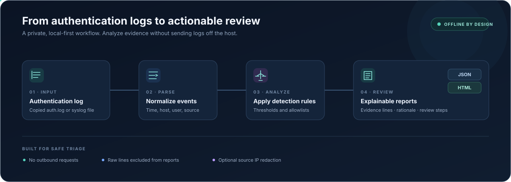

# AuthGuard — Linux Authentication Log Analyzer

[](https://github.com/FAHAD-s3do/FAHAD-s3do/actions/workflows/authguard-triage.yml)
[](https://www.python.org/)
[](LICENSE)

**Offline Linux authentication log analysis with explainable findings.** AuthGuard combines current and rotated `auth.log` files, including gzip archives, into one timeline and portable JSON or HTML reports. It uses the Python standard library at runtime and makes no network requests.

## How it works



The animation is decorative; the same workflow is described in the detection and reporting sections below.

## Detection coverage

| Pattern | Default severity | Evidence included |
|---|---|---|
| Repeated SSH failures from one source | High | Count, time range, source, and log line numbers |
| SSH failures across multiple usernames | High | Targeted account count and line numbers |
| Successful SSH login after repeated failures | High | Failed attempts and subsequent login |
| Direct SSH login as `root` | Critical | Login event and source |
| Local account creation | High | Account name and source line |

Thresholds and allowlists are configurable. Routine `sudo` activity is recorded but is not treated as suspicious by itself. Findings are review leads, not proof of compromise.

## Quick start

Requires Python 3.11 or newer.

```bash
git clone https://github.com/FAHAD-s3do/FAHAD-s3do.git
cd FAHAD-s3do/projects/authguard-triage
python -m venv .venv
```

Activate the environment for your shell, then install:

```powershell
.venv\Scripts\Activate.ps1
python -m pip install .
```

```bash
source .venv/bin/activate
python -m pip install .
```

Analyze a single log and create both report formats:

```bash
authguard /path/to/auth.log \
  --year 2026 \
  --timezone Asia/Karachi \
  --config config/example.json \
  --json out/report.json \
  --html out/report.html \
  --redact-ips
```

Analyze rotated logs together so detections can span the rotation boundary:

```bash
authguard /var/log/auth.log /var/log/auth.log.1 /var/log/auth.log.2.gz \
  --year 2026 \
  --timezone Asia/Karachi \
  --json out/incident.json \
  --html out/incident.html \
  --redact-ips
```

For classic syslog timestamps, set the year and timezone that apply to the source log. AuthGuard defaults to the current year and UTC.

## Example

Run the included synthetic log:

```bash
authguard examples/auth.log --year 2026 --json out/report.json --html out/report.html --redact-ips
```

The fixture demonstrates six findings across SSH failure bursts, a multi-account pattern, a login after failures, direct root access, and account creation. Its IP addresses are reserved for documentation.

- [Sample JSON report](examples/report.json)
- [Sample HTML report](examples/report.html)

In combined reports, evidence references identify the source and original line, such as `auth.log.1:42`.

Use `authguard --help` or `python -m authguard --help` to see all options. `--fail-on high` returns exit code 1 when a high or critical finding is present.

## Privacy and safe handling

- Reports include summaries, explanations, recommendations, and source file/line references; they omit raw log lines, sudo command text, and full local paths.
- Use `--redact-ips` before sharing reports when source addresses are not needed.
- Reports are written atomically, and output paths cannot overwrite the input log.
- Treat source logs and unredacted reports as sensitive operational data.

## Documentation

- [User guide](docs/USER_GUIDE.md): supported formats, configuration, command options, report fields, and troubleshooting.
- [Threat model and data handling](docs/THREAT_MODEL.md): trust boundaries, controls, and limitations.
- [Security policy](SECURITY.md): safe use and vulnerability reporting.
- [Contributing](CONTRIBUTING.md): development setup and change expectations.

## Development

```bash
python -m pip install --no-deps -e .
python -m unittest discover -s tests -v
authguard examples/auth.log --year 2026 --json out/report.json --html out/report.html --redact-ips
```

GitHub Actions runs the unit suite and analyzes the synthetic fixture on pushes and pull requests.

## Scope

AuthGuard is an offline triage aid, not an endpoint agent, SIEM, forensic acquisition system, or response tool. It does not block addresses, query hosts, fetch threat intelligence, or determine whether activity is malicious. Missing records, clock skew, NAT, shared accounts, and log format differences can affect results. Confirm findings against the original log and other available evidence.

Use only logs and systems you own or are authorized to review. Do not publish real authentication logs or reports containing operational identifiers without authorization.

## License

MIT. See [LICENSE](LICENSE).
